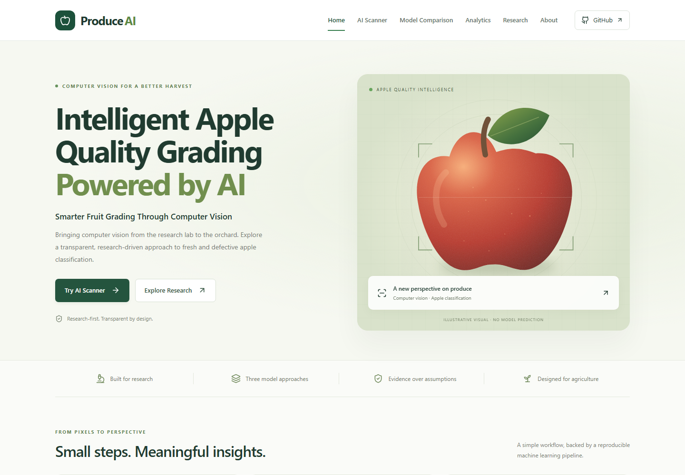
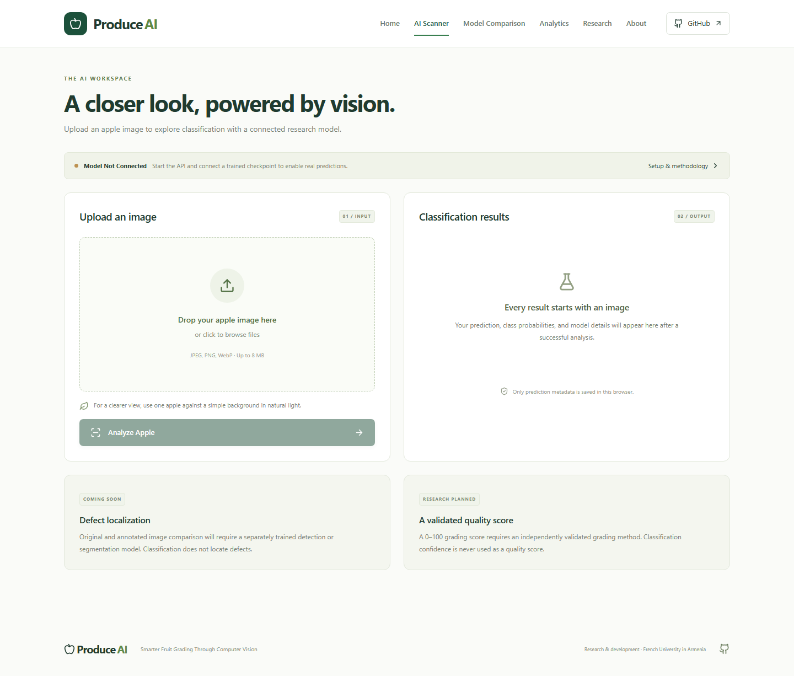

# ProduceAI

**Smarter Fruit Grading Through Computer Vision**

A React research application and independent FastAPI inference service for the **Computer-Vision Grading System for Local Produce Quality** project. Initial focus: fresh and visibly rotten/defective apples.

Developer: **Argishti Mnatsakanyan** · **French University in Armenia**

Status: **Research & Development**. Source infrastructure is implemented. No dataset, pretrained apple classifier, experimental accuracy, repository creation, or public deployment is claimed.

## What is included

- Six responsive pages: Home, AI Scanner, Model Comparison, Analytics, Research, About.
- Drag/drop upload, image preview, format and size validation, timeout/error handling, actual API response validation, probabilities, model identity, and measured latency.
- Local browser analytics based only on successful real API responses; no stored image content.
- Honest empty states for absent models and experiments. There is no simulated prediction mode.
- Three reproducible training approaches: OpenCV features + SVM, custom CNN, MobileNetV2 transfer learning.
- FastAPI health/OpenAPI endpoints, bounded multipart uploads, decoding limits, explicit CORS, CPU inference, and unavailable-model handling.
- GitHub Pages and API CI workflows, unit/API tests, and desktop/mobile Playwright checks.

Defect localization and 0–100 quality grading are **planned** and intentionally unavailable. A classifier does not locate defects, and its probabilities are not quality scores. Predictions do not establish food safety.

## Repository

```text
frontend/             React + TypeScript + Vite + Tailwind + Recharts + Lucide
backend/              FastAPI, Dockerfile, API tests
ml/                   split, train, evaluate, architectures, shared inference
experiments/          actual exported test results (empty initially)
docs/                 architecture, deployment, validation notes
.github/workflows/    frontend Pages deployment and API CI
```

## Frontend quick start

Requirements: Node 22+ and pnpm 11.25.0 (`corepack enable`, or install pnpm using its official instructions).

```sh
cd frontend
pnpm install --frozen-lockfile
# Copy .env.example to .env.local; VITE_API_URL must point to your API.
pnpm dev
```

Open http://127.0.0.1:5173/ProduceAI/ . Frontend runs without a backend and displays **Model Not Connected**. No result appears until a trained model answers the API.

```sh
pnpm lint
pnpm test
pnpm build
pnpm exec playwright install chromium
pnpm exec playwright test
```

## Backend quick start

Python 3.11 recommended. From the repository root:

```sh
python -m venv .venv
# Windows PowerShell: .venv\Scripts\Activate.ps1
# macOS/Linux: source .venv/bin/activate
python -m pip install -r backend/requirements.txt
python -m uvicorn backend.main:app --reload --host 127.0.0.1 --port 8000
python -m pytest backend/tests -q
```

Health: http://127.0.0.1:8000/health · API docs: http://127.0.0.1:8000/docs . Without MODEL_PATH, health is available and prediction returns 503. Environment files are examples, not automatically loaded by Python.

After training, PowerShell:

```powershell
$env:MODEL_PATH = 'models/mobilenet.pt'
$env:ALLOWED_ORIGINS = 'http://127.0.0.1:5173,http://localhost:5173'
python -m uvicorn backend.main:app --host 127.0.0.1 --port 8000
```

Bash equivalents: `export MODEL_PATH=models/mobilenet.pt` and `export ALLOWED_ORIGINS=http://127.0.0.1:5173,http://localhost:5173`.

## Dataset download & audit

No dataset is bundled. Obtain a dataset you have permission to use containing both fresh and rotten apples, for example by searching the Kaggle dataset catalog for **fresh and rotten apples**: https://www.kaggle.com/datasets?search=fresh+rotten+apples . Download from the original dataset page using your own authorized account if required. Verify the individual dataset license and provenance; catalog availability does not grant redistribution rights. Do not copy banana/orange folders into this binary apple study.

Organize the selected apple images into `data/apples/fresh/` and `data/apples/rotten/`. Inspect labels and class balance, remove duplicates, and audit capture groups and near duplicates. If the source already provides an authoritative held-out test set, preserve that set and author an equivalent provenance-bearing manifest rather than randomly resplitting it. The supplied default random split is appropriate only after capture groups are resolved. At least ten unique images per class are needed by the splitter; meaningful evaluation usually requires substantially more, representative images.

## Reproducible training and evaluation

Run all commands from the repository root with the Python environment active:

```sh
python -m ml.split --data data/apples --source "REPLACE_WITH_ACTUAL_DATASET_URL" --license "REPLACE_WITH_VERIFIED_LICENSE" --seed 42
python -m ml.eda
python -m ml.train --model baseline --version 0.1.0
python -m ml.train --model cnn --epochs 15 --version 0.1.0
python -m ml.train --model mobilenet --epochs 15 --version 0.1.0
python -m ml.evaluate --checkpoint models/baseline.joblib
python -m ml.evaluate --checkpoint models/cnn.pt
python -m ml.evaluate --checkpoint models/mobilenet.pt
```

MobileNetV2 initialization downloads official ImageNet weights from PyTorch on the first training run; these are **not an apple classifier**. Only the task-specific final classifier is trained; the pretrained backbone and BatchNorm statistics stay frozen. CNN trains from scratch. Training runs on CPU for portability and records seeds, manifest hashes, class order, hyperparameters, selected checkpoint epoch, and losses. Exact cross-platform bitwise reproducibility is not guaranteed across different dependency/hardware versions. Save a `pip freeze` snapshot alongside every actual research run; the requirements here specify compatibility ranges, not an executed experiment environment lock.

Metrics use macro precision/recall/F1 and class order `[Fresh Apple, Rotten or Defective Apple]`; confusion matrix rows are actual, columns predicted. Latency is a warmed-up CPU mean including preprocessing and inference, excluding upload and image decoding. Record hardware and Python/package versions with reported results. Do not tune models repeatedly against the test set.

Copy the resulting JSON for the frontend (PowerShell):

```powershell
Copy-Item experiments/results.json frontend/public/experiments/results.json
```

Then rebuild. Empty JSON files intentionally contain no performance numbers. Checkpoints and data are gitignored. Train with clean licensed data; use external versioned model storage for deployment. Both Torch weights and SVM artifacts carry the same class mapping. Only load checkpoints you trust.

## Deployment

See [docs/DEPLOYMENT.md](docs/DEPLOYMENT.md) for official browser authorization/manual GitHub connection, repo creation, Pages configuration, environment variables, backend container hosting, costs, and release checklist. No password or personal access token should ever be pasted into chat or committed.

Target frontend URL after deployment: https://mnacakanyanargisti-rgb.github.io/ProduceAI/ . Vite base is `/ProduceAI/`; navigation uses hash routes. GitHub Pages serves static files; the API requires separate HTTPS hosting.

## Screenshots





Mobile and full-page captures are also available in docs/screenshots/.

The homepage contains a locally authored SVG apple illustration labeled as illustrative, not a real inference overlay. After launching the app, capture the homepage and scanner at desktop/mobile widths for presentations. See docs/VALIDATION.md for actual checks completed for this delivery; do not present design illustrations as model detections.

## Architecture and future work

See [docs/ARCHITECTURE.md](docs/ARCHITECTURE.md). Next steps: licensed dataset audit, actual training, local orchard validation, uncertainty calibration, out-of-distribution handling, capture-group-aware splits, annotated detection datasets, and expert-validated grading. Authentication, shared analytics, persistence, and public-service resource controls require further deployment work.

## References

- Vite deployment and repository base: https://vite.dev/guide/static-deploy.html
- Official MobileNetV2 API: https://docs.pytorch.org/vision/stable/models/generated/torchvision.models.mobilenet_v2.html
- FastAPI documentation: https://fastapi.tiangolo.com/

MIT license applies to application source. Dataset and pretrained-weight licenses must be reviewed separately.
