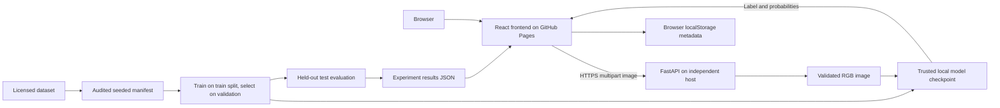

# Architecture

The frontend is static. GitHub Pages cannot execute the Python service. Vite embeds VITE_API_URL at build time. Hash routes keep every navigation request at /ProduceAI/ and need no server rewrite.

Images are sent to the configured API and are not persistently retained by this implementation. Multipart parsing may spool a temporary file that is closed after the request. The browser retains only up to 500 prediction metadata records. Clearing browser storage removes these records. API server access logs and infrastructure may retain request metadata depending on host configuration.

GET /health returns service status, model_loaded, model_name, model_version, and capability flags. A healthy API may have no model. POST /predict accepts one multipart file field named file, restricts accepted MIME types and decoded formats, enforces 8 MiB file size and a 20-million-pixel decoding limit, applies EXIF orientation, and serializes inference on CPU. A bounded request-body middleware also handles missing Content-Length. Errors: 413 size/empty, 415 format, 422 invalid image/missing file, 503 missing model, 500 inference failure. Interactive OpenAPI documentation: /docs.

Model deserialization is limited to an operator-controlled MODEL_PATH. PyTorch uses weights_only=True; joblib artifacts must be trusted because they can execute code on load. Users cannot upload checkpoints through the API. Weights and datasets are excluded from Git. Host model artifacts privately or use a versioned external model registry; record hashes and license. Git LFS is another option for intentionally versioned weights, but not necessary for this package.

This is a research deployment foundation. Before a public production service, add edge rate limiting, request concurrency limits, resource monitoring, HTTPS, dependency scanning, and an access policy appropriate to the use case. CORS alone does not provide authentication or rate limiting.
