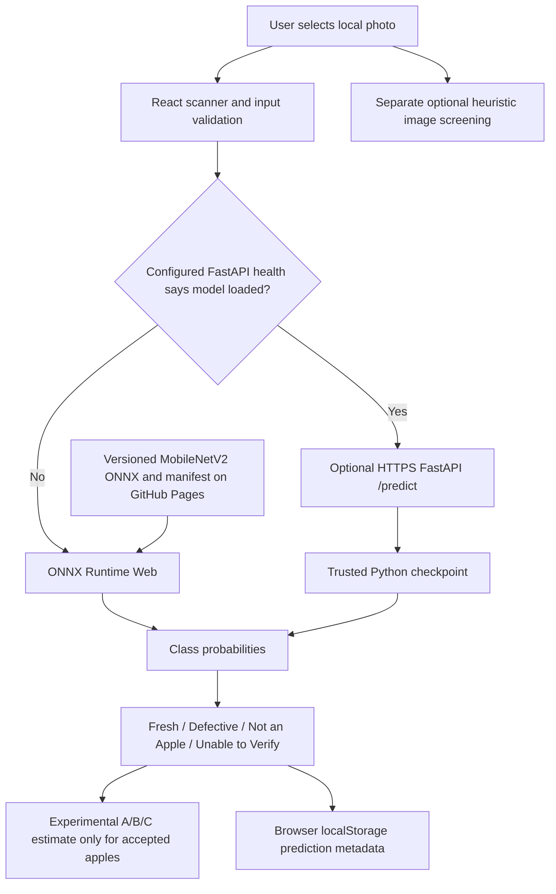
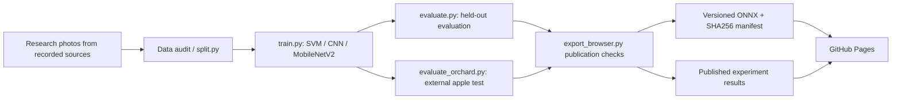

# ProduceAI architecture (current research build)

The public [ProduceAI website](https://mnacakanyanargisti-rgb.github.io/ProduceAI/) is a **static React/TypeScript application** on GitHub Pages. Its published three-class MobileNetV2 **ONNX** model runs in the visitor's own browser with ONNX Runtime Web. A Python/FastAPI inference service also exists in the repository but is **optional** and must be deployed separately if used.

## Current inference architecture

**Privacy details:** On-device ONNX classification does not upload photos to the optional API; the model and ONNX runtime engine are downloaded to the browser. If a separately hosted API is configured and reports a loaded model, the application **does upload** the selected image to that API for prediction. A local browser history stores metadata (up to 500 recent accepted prediction records), not photo bytes. API infrastructure may log request metadata.

**Browser code:** `frontend/src/browser-model.ts` reads `frontend/public/models/manifest.json`, fetches the published `apple-mobilenet-open-set-v3.onnx`, preprocesses to 224×224 normalized RGB, and runs inference with ONNX Runtime Web. It uses guarded crop rechecks for certain portrait photographs and an abstention state for ambiguous scores. `frontend/src/apple-grading.ts` derives a research A/B/C category from conditional apple-class probabilities, **not from defect masks or direct freshness measurements**. `frontend/src/visual-analysis.ts` is an independent heuristic and **not a learned detector**.

**Optional API:** `backend/main.py` exposes `GET /health`, `POST /predict`, and interactive `/docs`. The API reports model availability separately from server health; without `MODEL_PATH` prediction returns 503. It validates the input's type, 8 MiB size ceiling, decoded format, decoded-image pixel limit, and orientation; it applies explicit CORS settings and serialized CPU inference. CORS is not access control. GitHub Pages cannot run this Python process.

## Training, evaluation and publication pipeline

The splitter produces a seeded, stratified manifest with about **70% training, 15% validation, 15% testing**. It rejects exact-byte duplicates but does **not** guarantee removal of visually similar captures or session leakage. The model has three classes: `Fresh Apple`, `Rotten or Defective Apple`, `Not an Apple`. SVM features include OpenCV-derived HSV histograms and grayscale texture statistics; CNN and MobileNetV2 use image tensors. Current publication contains a MobileNetV2 evaluation, **not** a measured three-way model comparison.

GitHub Actions trains, evaluates and publishes a guarded ONNX artifact (see `.github/workflows/train-apples.yml` and `publish-model.yml`). Pages CI runs lint, unit tests, build, browser tests, and artifact-integrity checks. The public results live in `frontend/public/experiments/results.json`; `experiments/results.json` is the mirrored, checked-in research snapshot. Future publish runs should update **both**.

## Honest interpretation and limitations

- Image **classification** says which broad label is predicted. It does not localize blemishes or identify the percentage of genuinely damaged surface.
- The A/B/C score is calculated from fresh-versus-defective class probabilities, **not** measured freshness or regulatory quality.
- Held-out performance does not imply performance on photos from Armenia: the so-called external orchard evaluation uses a separate published dataset. That dataset's upstream held-out images are not a field study personally collected in Armenia.
- Different lighting, backgrounds, cultivars, cropping, and unlabeled object categories can lead to errors. `Unable to Verify` should be treated as a request for manual review, not proof of absence of apples.
- Dataset rights must be reviewed individually. The tracked workflow records unverified rights, and some sources are described as academic-only. Do not treat this implementation as commercial-ready.

## Security and deployment

GitHub Pages deploys static assets with Vite's `/ProduceAI/` base path and hash-based navigation. The optional FastAPI service needs independent HTTPS hosting, origin allowlisting, resource limits, and an explicit security/privacy policy. On-device classification removes the need for an API for the default published website but does not establish complete offline availability, as browser assets and the ONNX runtime are initially fetched.

Never accept a user-supplied checkpoint for deserialization; `joblib` and PyTorch weights must be trusted. Keep datasets, private absolute paths, credentials and internal checkpoint files out of ordinary source commits. The deliberately distributed browser ONNX file is publicly readable.
